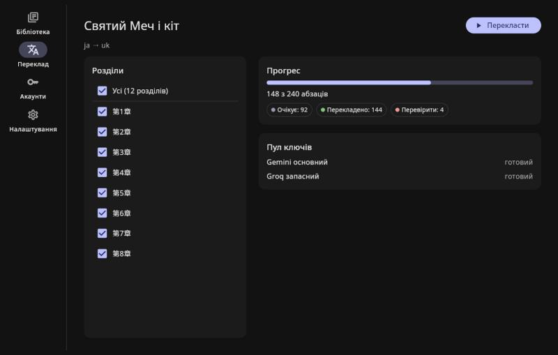
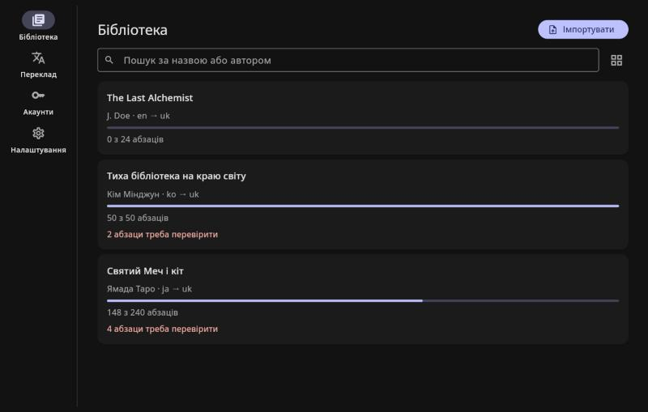
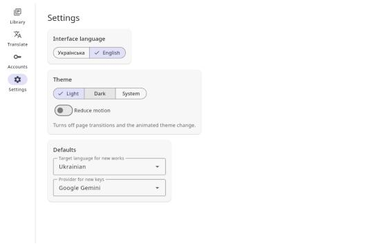
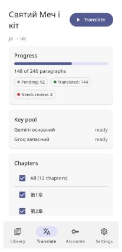
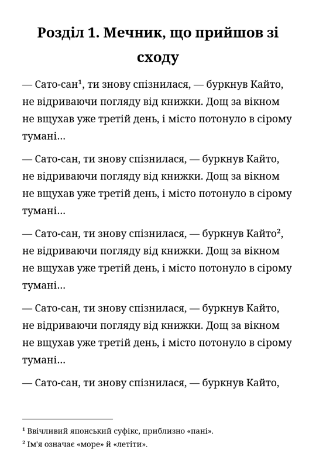

<div align="center">

# Ranobe Translator

**Перекладач ранобе й веб-новел з японської, корейської та англійської на українську (і англійську), який пам'ятає контекст.**

[](https://github.com/nicknamesoon-hash/ranobe-translate/actions/workflows/ci.yml)


[](LICENSE)

[English summary](#english) · [Можливості](#можливості) · [Встановлення](#встановлення) · [Як це працює](#як-це-працює) · [Дорожня карта](ROADMAP.md)



</div>

## Можливості

- **Переклад із контекстом.** Кожен запит отримує резюме сюжету, кінець попереднього фрагмента й глосарій саме для цього тексту, тож імена й терміни не «пливуть» між розділами.
- **Безкоштовні ключі як один пул.** Gemini, Groq, Mistral, OpenRouter (і платний DeepSeek): коли ліміт одного ключа вичерпано, переклад продовжується на наступному без втрати контексту.
- **Пауза й відновлення.** Переклад можна зупинити будь-коли, після збою чи вичерпання квоти він продовжиться з першого неперекладеного абзацу.
- **Редакторська модель.** Модель позначає спірні місця з варіантами на вибір; вибір іде в глосарій як незмінний. Примітки до реалій і гри слів (лише при першій появі). Черга пропозицій глосарію на підтвердження.
- **Рівні цензури.** Оригінал, пом'якшений чи сімейний рівень; будь-який абзац можна перекласти заново з іншим рівнем. Відмови моделі виявляються й позначаються для перевірки, а не підставляються мовчки.
- **Другий прохід редагування** за чеклістом якості (режим «Якість»).
- **Експорт** у TXT, EPUB 3 зі спливаючими виносками й обкладинкою, CBZ (сторінки-зображення з примітками внизу).
- **Імпорт** TXT (будь-яке кодування: UTF-8/16, Shift_JIS, GBK, cp1251), EPUB, CBZ.
- **Інтерфейс** українською й англійською, світла й темна тема, адаптивний від телефона до широкого монітора.
- **Безпека ключів.** API-ключі зберігаються в системному сховищі (Windows Credential Manager, Keychain, Secret Service) або в зашифрованому майстер-паролем файлі; у логах вони маскуються.

<table>
  <tr>
    <td></td>
    <td></td>
  </tr>
  <tr>
    <td align="center">Бібліотека з прогресом перекладу</td>
    <td align="center">Налаштування: мова й тема без перезапуску</td>
  </tr>
  <tr>
    <td align="center"></td>
    <td align="center"></td>
  </tr>
  <tr>
    <td align="center">Той самий застосунок на вузькому екрані</td>
    <td align="center">Експорт у CBZ: примітки внизу сторінки</td>
  </tr>
</table>

## Встановлення

Готових збірок ще немає (з'являться в [Releases](https://github.com/nicknamesoon-hash/ranobe-translate/releases)). Поки що запуск із коду, потрібен Python 3.12+:

```bash
git clone https://github.com/nicknamesoon-hash/ranobe-translate.git
cd ranobe-translate
python -m venv .venv
.venv\Scripts\pip install -e ".[ui]"      # Linux/macOS: .venv/bin/pip
.venv\Scripts\python -m ranobe            # або: python -m ranobe --web (у браузері)
```

Далі: **Акаунти → Додати ключ** (там же посилання, де взяти безкоштовний ключ), потім **Бібліотека → Імпортувати** і **Переклад**.

## Як це працює

1. Книжка розбивається на сегменти (абзаци) з урахуванням CJK-письма; кожен сегмент має власний статус.
2. Сегменти збираються в чанки під бюджет токенів моделі.
3. Промт збирається щоразу заново зі збереженого стану: правила перекладу для цільової мови, рівень цензури, режим японських суфіксів, релевантний глосарій, резюме сюжету й хвіст попереднього фрагмента. Тому будь-який ключ будь-якого провайдера може продовжити з будь-якого місця.
4. Відповідь моделі (JSON) суворо перевіряється: кожен сегмент рівно один раз, коректні спірні моменти й примітки. Помилка → повтор із підказкою, далі поділ чанка, далі позначка «перевірити».
5. Результат чанка записується в SQLite однією транзакцією.

Докладно: [ARCHITECTURE.md](ARCHITECTURE.md). Що далі: [ROADMAP.md](ROADMAP.md) (редактор і режим читання, обкладинки, синхронізація, оновлення однією кнопкою).

## Командний рядок

Ядро працює й без інтерфейсу:

```bash
ranobe-cli providers                                  # де взяти безкоштовні ключі
ranobe-cli accounts add --provider gemini --label main --rpm 8 --priority 10
ranobe-cli import book.epub --from ja --to uk
ranobe-cli translate <id>                             # Ctrl+C — пауза, повторний запуск продовжує
ranobe-cli disputes list <id>                         # спірні місця, * = зараз у тексті
ranobe-cli disputes resolve <dispute> --option 2      # або --custom "..."
ranobe-cli glossary list <id> --pending               # пропозиції глосарію
ranobe-cli export <id> book.epub --cover cover.jpg    # також .txt, .cbz
```

Дані зберігаються в `%APPDATA%\RanobeTranslator` (Windows) або `~/.local/share/ranobe-translator` (Linux); інша папка: змінна `RANOBE_DATA_DIR`.

## Розробка

```bash
pip install -e ".[dev,ui]"
pytest -q
ruff check . && ruff format --check .
```

Шарова архітектура: `core/` (чиста логіка) → `services/` (провайдери, імпорт/експорт, секрети) → `ui/` (Flet). Нові провайдери, формати й мови додаються через реєстри. Усі рядки інтерфейсу йдуть через i18n (`src/ranobe/i18n/locales`). LLM у тестах мокаються.

## English

Ranobe Translator is a desktop (and, soon, Android) app that translates light novels and web novels from Japanese, Korean and English into Ukrainian or English using free-tier LLM APIs. It keeps a running plot summary, a per-work glossary and the tail of the previous passage in every request, rotates across keys and providers when a quota runs out, resumes after any interruption, flags disputed renderings and model refusals for review, and exports to TXT, EPUB 3 (pop-up footnotes) and CBZ. Interface in Ukrainian and English. Status: alpha, built with Python and [Flet](https://flet.dev).

## Ліцензія

[MIT](LICENSE). Шрифти мають власну ліцензію, див. нижче.

## Шрифти й сторонні матеріали

У застосунок вбудовано шрифти [Noto Sans і Noto Serif](https://notofonts.github.io/) під ліцензією SIL Open Font License 1.1 (`src/ranobe/assets/fonts/OFL.txt`).
